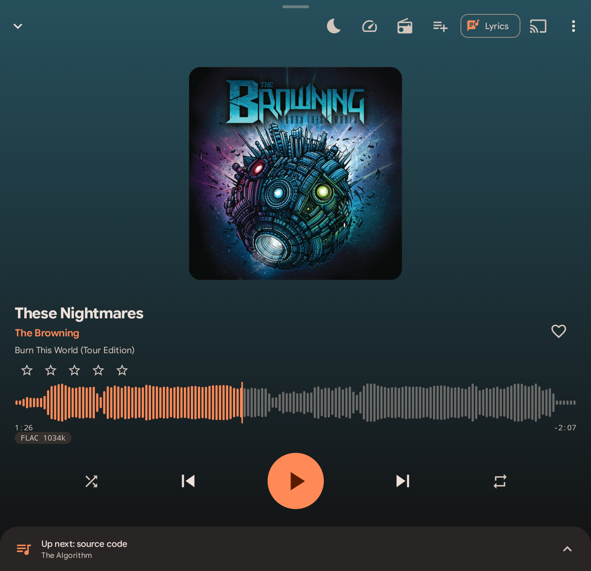
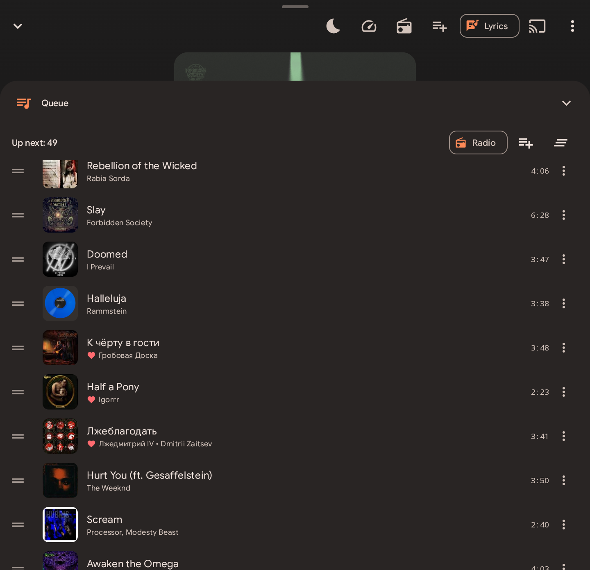
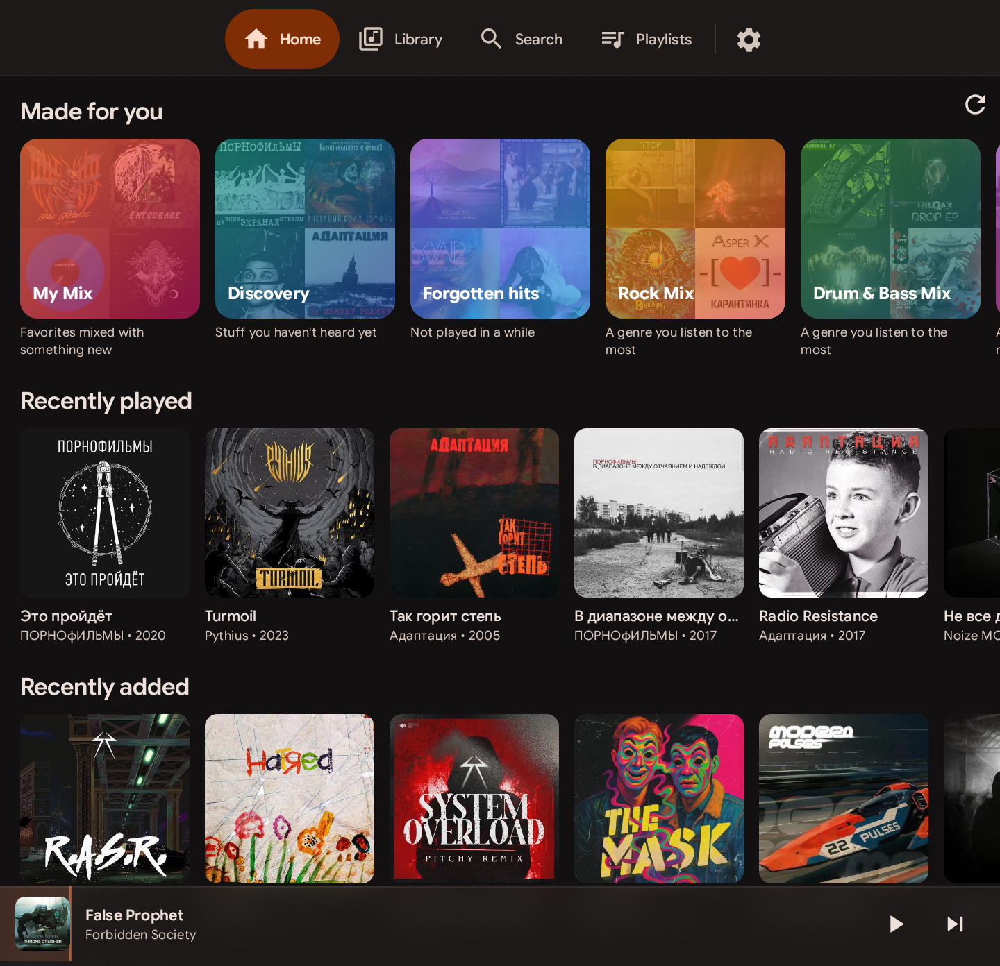
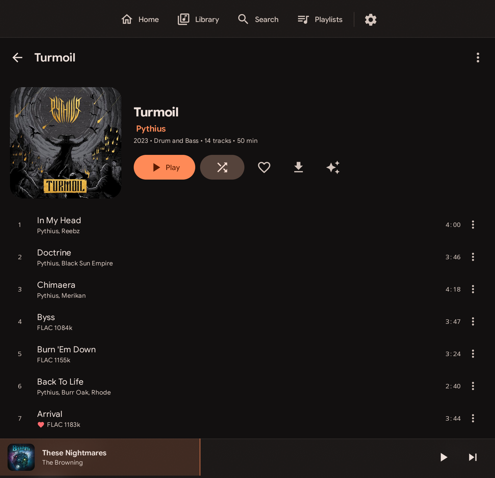
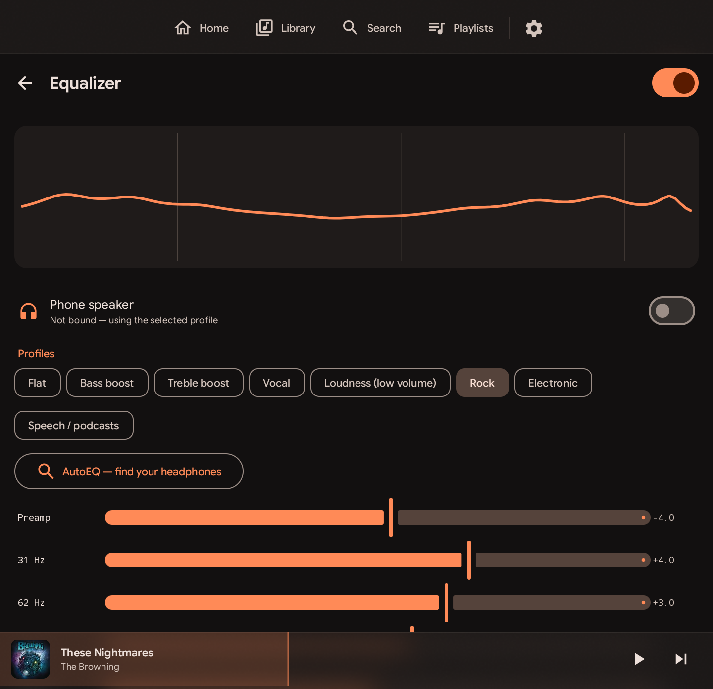

<p align="center">
  
</p>

<h1 align="center">Slurpdrome</h1>

<p align="center">A music player for your own <a href="https://www.navidrome.org/">Navidrome</a> server and the music on your phone —<br>built for touchscreens and keypad phones alike.</p>

<p align="center"><b>English</b> · <a href="README.ru.md">Русский</a></p>

<p align="center">
  <a href="LICENSE"></a>
  
  <a href="https://github.com/Serlk/slurpdrome/releases"></a>
</p>

<table>
  <tr>
    <td align="center" width="33%"><br><sub>Player — waveform seek bar, swipe to skip</sub></td>
    <td align="center" width="33%"><br><sub>Queue — drag to reorder</sub></td>
    <td align="center" width="33%"><br><sub>Home — recently added, most played, favorites</sub></td>
  </tr>
  <tr>
    <td align="center" width="33%"><br><sub>Library — one view over all sources</sub></td>
    <td align="center" width="33%"><br><sub>Album</sub></td>
    <td align="center" width="33%"><br><sub>Equalizer — AutoEQ headphone profiles</sub></td>
  </tr>
</table>

Kotlin · Jetpack Compose · Media3 · Room · minSdk 26.

## Features
- **One library from many sources** — any number of Navidrome servers plus music on the phone, merged without restarts; duplicates across sources are folded into one entry.
- **Offline first** — LRU stream cache (up to 100 GB), explicit downloads, optional auto-download of favorites (off by default), Wi-Fi / mobile-data aware background downloads.
- **Player** — gapless playback or crossfade (dual-player, equal-power; albums stay gapless), ReplayGain, endless continuation for mixes and radio (your own playlists stop at the end), waveform seek bar once a track is fully cached, swipe anywhere to skip, double-tap the cover to like, queue in a pull-up panel with drag-and-drop (Shift+↑/↓ on a keyboard), synced lyrics.
- **Equalizer** — custom DSP (RBJ biquads, preamp, limiter), ~8800 AutoEQ headphone profiles, per-output-device switching.
- **Mixes and smart playlists**, device-local playlists mixing tracks from several sources.
- **CUE images** — single-file albums with an embedded CUESHEET are split into virtual tracks.
- **Audiobooks** — resume points synced with Navidrome bookmarks, bookmarks, separate speed.
- **Play on other devices** — Chromecast and DLNA/UPnP renderers (receivers, speakers, TVs) from one "Play on" picker; the renderer gets the next track in advance so it continues even while the phone sleeps.
- **Android Auto, home-screen widget.**
- **D-pad and hardware keyboard** are first-class: focus rings, Enter/Menu handling, hotkeys (`?` or F1 lists them), T9-style keypad mode.
- Light/dark themes following the system, accent colors, Material You; English and Russian UI following the phone language.

## Build
```sh
export JAVA_HOME=~/.local/jdk-17 ANDROID_HOME=~/Android/Sdk
./gradlew assembleFullRelease      # everything, incl. Chromecast (Google Play Services)
./gradlew assembleFossRelease      # F-Droid flavor: only free dependencies, no Chromecast (DLNA works)
./gradlew testFossDebugUnitTest    # logic tests + a live API test against demo.navidrome.org
```
Release APKs are signed when `keystore.properties` exists in the project root
(`storeFile`, `storePassword`, `keyAlias`, `keyPassword`); otherwise they are left unsigned.

## Sources
The library is assembled from any number of sources at once: Navidrome servers and music on the phone (MediaStore).
All ids are global — `<sourceId>~<rawId>` (`s1~abc`, `local~4521`) — and API calls are routed by that prefix
(`data/source/Sources.kt`). Each source syncs independently; one failing doesn't affect the others.
Navidrome playlists live on their server; smart playlists, mixes, search and the queue work across all sources.

## Duplicates and CUE
Identical albums/tracks from different sources are merged into one entry. At playback time the best copy is picked
(local > downloaded > reachable server by priority > quality), with automatic failover to another copy on errors.
Image albums (one FLAC with an embedded CUESHEET) are split into virtual tracks; `tools/embed-cue.sh` embeds external
.cue files into FLACs on the server.

## Architecture
- `data/api` — Subsonic/OpenSubsonic client (token auth, retry/backoff for idempotent calls, adaptive connection reuse).
- `data/db` — Room: full library mirror, downloads, offline pins, play history, pending actions, lyrics, smart playlists, queue.
- `data/repo` — sync, `DownloadManager` (offline rules + WorkManager), `MixEngine` (recommendations), `SmartQuery` (rules → SQL), lyrics (OpenSubsonic + LRC).
- `data/source` — source registry, dedup (`Deduper`), CUE parsing/splitting, MediaStore scanner, artwork provider.
- `player` — `PlaybackService` (ExoPlayer + LRU stream cache, prefetch of the next 2 tracks, scrobbling, ReplayGain, endless radio, queue restore, copy failover), `PlayerConnection` for the UI, `Waveform` (loudness profile via MediaCodec).
- `player/eq` — DSP inside ExoPlayer's audio pipeline, AutoEQ profiles, output-device detection.
- `player/LibraryTree.kt` — browse tree for Android Auto (`MediaLibraryService`).
- Chromecast — `CastPlayer`, queue/position handover in both directions.
- `player/dlna` — SSDP discovery, UPnP AVTransport/RenderingControl client, `DlnaPlayer` (a Media3 `SimpleBasePlayer`) that the session switches to like Chromecast.
- `widget` — adaptive Glance widget; the service publishes its state.
- `ui` — Compose; draggable player sheet (`ui/components/PlayerSheet.kt`), frosted-glass bars (Haze), D-pad focus handling (`ui/components/Focus.kt`), hotkeys (`ui/keys/Hotkeys.kt`), themes with a palette generator seeded from the accent color.

## Offline
Two layers: an LRU stream cache (keyed by song + quality) and explicit downloads. A track is kept if any rule wants it:
a manual download, "Auto-save favorites" (off by default), or a pinned album/artist/playlist/smart playlist.
Stars, ratings and scrobbles made without a connection are sent once it's back.

## License
[GPL-3.0-or-later](LICENSE).

## Roadmap
The Titan 2 rear screen, .lrc lyrics for local files.
