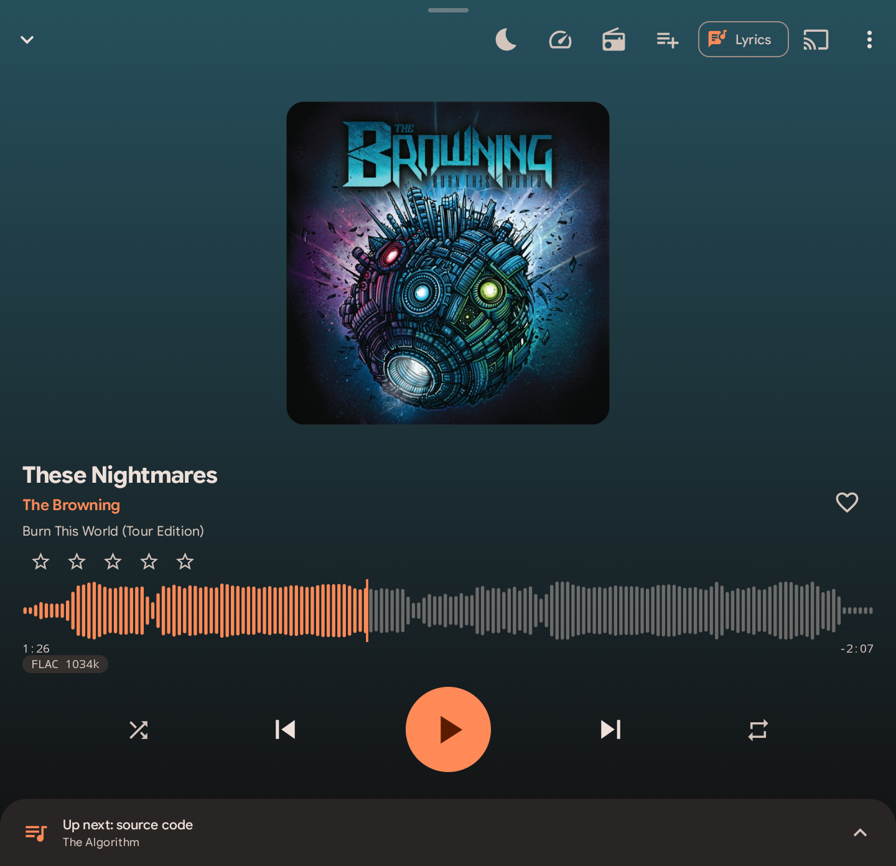
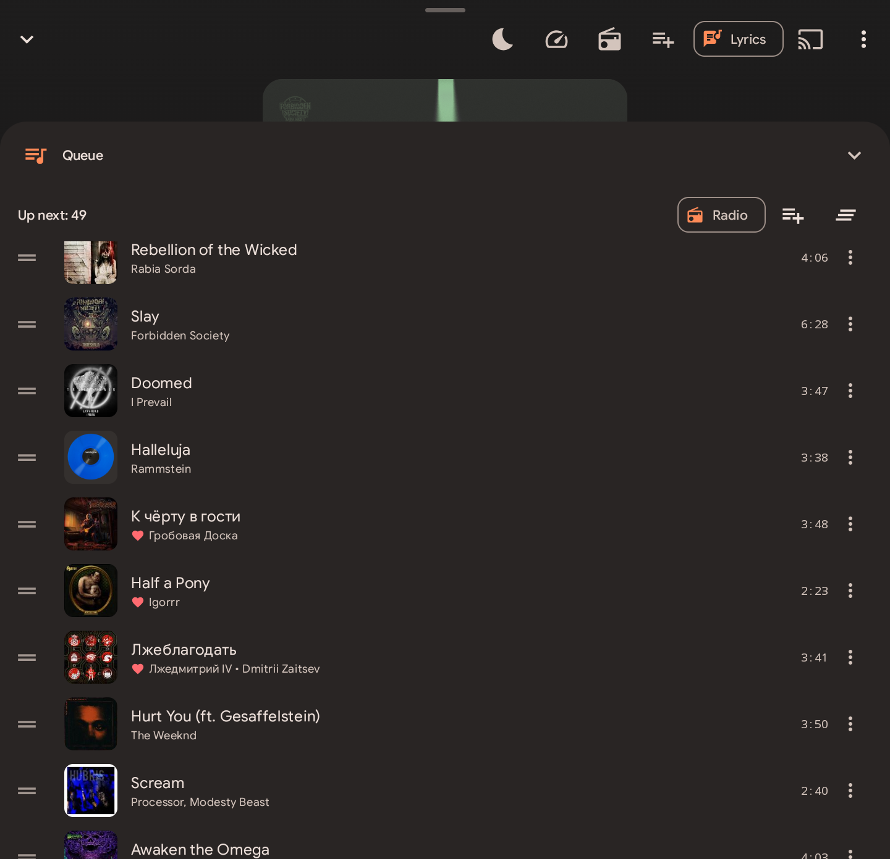
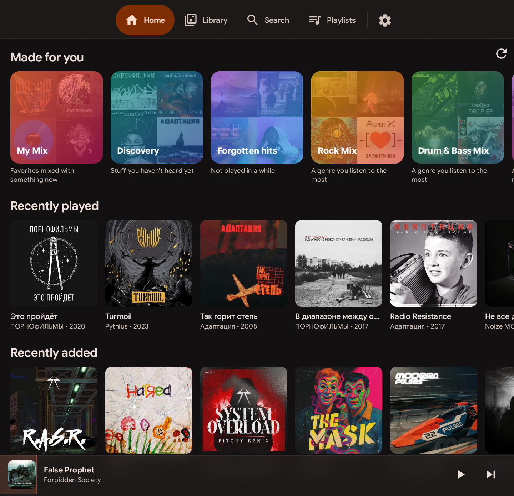
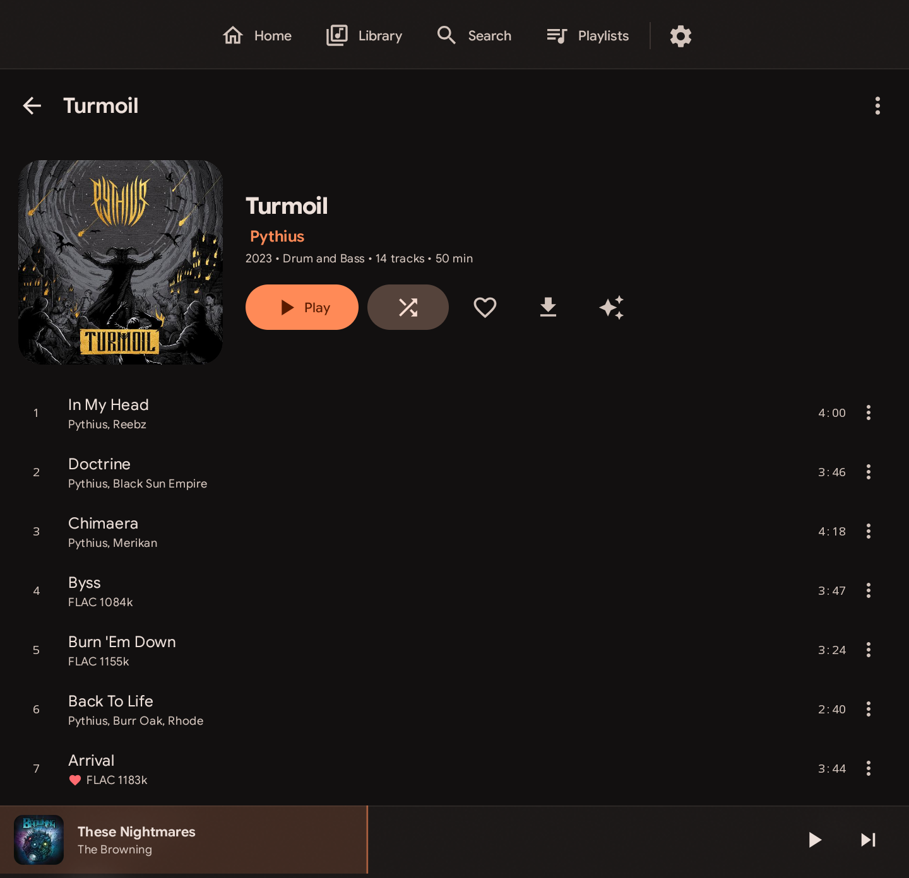
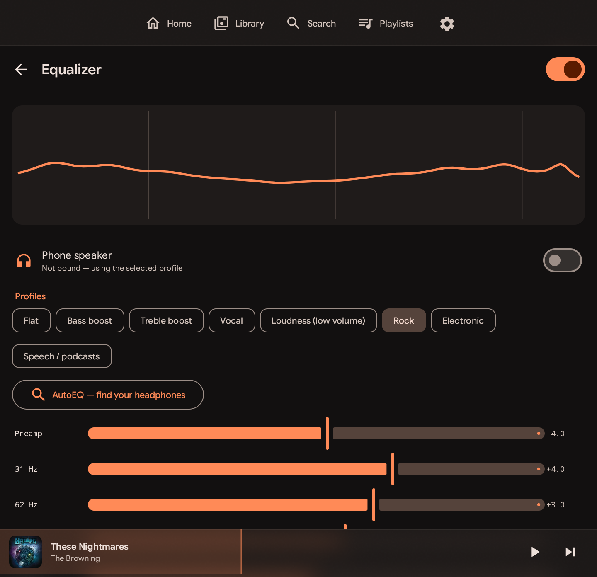

<p align="center">
  
</p>

<h1 align="center">Slurpdrome</h1>

<p align="center">Музыкальный плеер для своего сервера <a href="https://www.navidrome.org/">Navidrome</a> и музыки на телефоне —<br>одинаково удобный с сенсорным экраном и с кнопками.</p>

<p align="center"><a href="README.md">English</a> · <b>Русский</b></p>

<p align="center">
  <a href="LICENSE"></a>
  
  <a href="https://github.com/Serlk/slurpdrome/releases"></a>
</p>

<table>
  <tr>
    <td align="center" width="33%"><br><sub>Плеер — волна вместо ползунка, свайп для переключения</sub></td>
    <td align="center" width="33%"><br><sub>Очередь — перетаскивание</sub></td>
    <td align="center" width="33%"><br><sub>Главная — новое, частое, избранное</sub></td>
  </tr>
  <tr>
    <td align="center" width="33%"><br><sub>Медиатека — все источники в одном месте</sub></td>
    <td align="center" width="33%"><br><sub>Альбом</sub></td>
    <td align="center" width="33%"><br><sub>Эквалайзер — профили наушников AutoEQ</sub></td>
  </tr>
</table>

Kotlin · Jetpack Compose · Media3 · Room · minSdk 26.

## Сборка
```sh
export JAVA_HOME=~/.local/jdk-17 ANDROID_HOME=~/Android/Sdk
./gradlew assembleFullRelease      # всё, включая Chromecast (Google Play Services)
./gradlew assembleFossRelease      # вариант для F-Droid: только свободные зависимости, без Chromecast (DLNA работает)
./gradlew testFossDebugUnitTest    # логика + живой тест API против demo.navidrome.org
```
Release-APK подписываются, если в корне проекта есть `keystore.properties`
(`storeFile`, `storePassword`, `keyAlias`, `keyPassword`); иначе остаются неподписанными.

## Источники
Медиатека собирается из любого числа источников одновременно: серверы Navidrome и музыка на телефоне (MediaStore).
Все id глобальные — `<sourceId>~<rawId>` (`s1~abc`, `local~4521`), запросы к API маршрутизируются по префиксу
(`data/source/Sources.kt`). Синхронизация идёт по каждому источнику отдельно; сбой одного не трогает остальные.
Плейлисты Navidrome живут на своём сервере; умные плейлисты, миксы, поиск и очередь — поверх всех источников.

## Архитектура
- `data/api` — Subsonic/OpenSubsonic клиент (token-auth, retry/backoff для идемпотентных вызовов).
- `data/db` — Room: полное зеркало библиотеки, загрузки, офлайн-пины, история прослушиваний, отложенные действия, тексты, умные плейлисты, очередь.
- `data/repo` — синхронизация, `DownloadManager` (правила офлайна + WorkManager), `MixEngine` (рекомендации), `SmartQuery` (правила → SQL), тексты (OpenSubsonic + LRC).
- `player` — `PlaybackService` (ExoPlayer + LRU-кеш стрима, предзагрузка 2 треков, скробблинг, ReplayGain, бесконечное радио, восстановление очереди), `PlayerConnection` для UI.
- `player/eq` — свой DSP в аудиоконвейере ExoPlayer: RBJ-биквады, предусиление, лимитер; профили AutoEQ (≈8800) и автопереключение по устройству вывода.
- `player/LibraryTree.kt` — дерево каталога для Android Auto (`MediaLibraryService`).
- Chromecast — `CastPlayer`, передача очереди/позиции при подключении и обратно.
- `widget` — адаптивный виджет на Glance; состояние публикует сервис.
- `data/repo/AudiobookRepository.kt` — позиции возобновления (синхронизируются с закладками Navidrome), закладки, отдельная скорость.
- `data/source/ArtworkProvider.kt` — content:// обложки для уведомления, Auto, виджета и локальных файлов.
- `ui` — Compose; выдвижной плеер следует за пальцем (`ui/components/PlayerSheet.kt`), фокус-кольца и Menu/M для D-pad, хоткеи (`ui/keys/Hotkeys.kt`), темы с генератором палитры от акцентного цвета.

## Другие устройства
Chromecast и DLNA/UPnP-ресиверы выбираются в одном диалоге «Где играть». Ресивер заранее получает следующий трек
(SetNextAVTransportURI) и продолжает играть, даже если телефон уснул. Код — `player/dlna`.

## Офлайн
Два слоя: LRU-кеш стриминга (ключ = песня+качество) и явные загрузки. Трек хранится, если его хочет хоть одно правило:
ручная загрузка, «Автосохранение избранного» (по умолчанию выкл.), закреплённый альбом/исполнитель/плейлист/умный плейлист.
Избранное, рейтинги и скробблы, сделанные без сети, отправляются при появлении связи.

## Дубли и CUE
Одинаковые альбомы/треки из разных источников сливаются в одну запись; при воспроизведении выбирается лучшая копия
(локальная > скачанная > доступный сервер по приоритету > качество), при ошибке — переключение на другую копию.
Альбомы-образы (один FLAC + встроенный CUESHEET) делятся на виртуальные треки; `tools/embed-cue.sh` встраивает внешние .cue на сервере.

## Лицензия
[GPL-3.0-or-later](LICENSE).

## Roadmap
Задний экран Titan 2, тексты из .lrc для локальных файлов.
